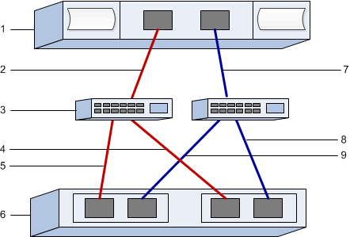

= 配置 E 系列中 VMware 的 FC 交换机和主机标识符
:allow-uri-read: 
:icons: font
:imagesdir: ../media/

[role="lead"]
对于光纤通道协议 (FCP)，您可以配置交换机并确定主机端口标识符。

NOTE: 在使用 4096 字节驱动器时，必须将卷设置为使用 512 字节仿真（512e），以确保与 VMware 的兼容性。有关将卷设置为使用 512 字节仿真（512e）的详细信息，请参见 SANtricity System Manager 联机帮助。

[[step-1-record-your-configuration]]
== 步骤 1：记录您的配置

您可以生成并打印此页面的 PDF，然后使用以下工作表记录 FC 存储配置信息。执行配置任务时需要此信息。

图示显示了在两个区域中连接到 E 系列存储阵列的主机。一个区域用红线表示；另一个区域用蓝线表示。每个区域至少包含一个启动器端口和所有目标端口的一半。主机和/或控制器端口的数量将根据主机总线适配器的数量和控制器型号而有所不同。您可能有更多可用端口（每个控制器最多 12 个）。根据需要打印其他 PDF。

[[host-identifiers]]
=== 主机标识符

|===
| 标注编号 | 主机（启动程序）端口连接 | WWPN 

 a| 
1.
 a| 
主机
 a| 
_ 不适用 _

 a| 
2.
 a| 
主机端口 0 到 FC 交换机分区 0
 a| 

 a| 
7.
 a| 
主机端口 1 到 FC 交换机分区 1
 a| 

|===

[[target-identifiers]]
=== 目标标识符

|===
| 标注编号 | 阵列控制器（目标）端口连接 | WWPN 

 a| 
3.
 a| 
交换机
 a| 
_ 不适用 _

 a| 
6.
 a| 
阵列控制器（目标）
 a| 
_ 不适用 _

 a| 
5.
 a| 
控制器 A ，端口 1 到 FC 交换机 1
 a| 

 a| 
5.
 a| 
控制器 A，端口 2 到 FC 交换机 1
 a| 

 a| 
9
 a| 
控制器 A，端口 3 到 FC 交换机 2
 a| 

 a| 
9
 a| 
控制器 A，端口 4 到 FC 交换机 2
 a| 

 a| 
4.
 a| 
控制器 B ，端口 1 到 FC 交换机 1
 a| 

 a| 
4.
 a| 
控制器 B，端口 2 到 FC 交换机 1
 a| 

 a| 
8.
 a| 
控制器 B，端口 3 到 FC 交换机 2
 a| 

 a| 
8.
 a| 
控制器 B，端口 4 到 FC 交换机 2
 a| 

|===

[[host-mapping-information]]
=== 主机映射信息

[cols="35h,~"]
|===
| 正在映射主机名 |  

| 主机操作系统类型 |  
|===

[[step-2-determine-the-host-port-wwpns]]
== 步骤 2：确定主机端口 WWPN

要配置 FC 分区，必须确定每个启动程序端口的全球通用端口名称（ WWPN ）。

.步骤
. 使用 SSH 或 ESXi shell 连接到 ESXi 主机。要启用 ESXi shell，请参见 https://knowledge.broadcom.com/external/article/311213/using-esxi-shell-in-esxi.html["在 ESXi 中使用 ESXi Shell"^]。
. 运行以下命令：
+
[listing]
----
esxcli storage core adapter list
----
. 记录启动器 WWPN 标识符（UID 格式为 - fc.WWNN:WWPN）。输出类似于以下示例：
+
[listing]
----
HBA Name  Driver    Link State  UID                                   Capabilities         Description
--------  --------  ----------  ------------------------------------  -------------------  -----------
vmhba4    lpfc      link-up     fc.200070b7e4395530:100070b7e4395530  Second Level Lun ID  (0000:5e:00.0) Emulex Corporation Emulex LPe35000/LPe36000 Fibre Channel Adapter
vmhba5    lpfc      link-up     fc.200070b7e4395531:100070b7e4395531  Second Level Lun ID  (0000:5e:00.1) Emulex Corporation Emulex LPe35000/LPe36000 Fibre Channel Adapter
vmhba64   lpfc      link-up     fc.200070b7e4395530:100070b7e4395530                       (0000:5e:00.0) Emulex Corporation Emulex LPe35000/LPe36000 Fibre Channel Adapter
vmhba65   lpfc      link-up     fc.200070b7e4395531:100070b7e4395531                       (0000:5e:00.1) Emulex Corporation Emulex LPe35000/LPe36000 Fibre Channel Adapter

----

在上面的示例中，vmhba4 和 vmhba64 以及 vmhba5 和 vmhba65 的 UID 是相同的。这对于同时支持 FCP 和 NVMe over FC 的 FC 适配器是正常现象。记录每个唯一的 WWPN。

NOTE: 另一个命令选项是 `esxcli storage san fc list`。这将以十六进制格式显示更多详细信息和 WWPN，并以冒号分隔。

[[step-3-configure-the-fc-switches]]
== 步骤 3：配置 FC 交换机

通过配置（分区）光纤通道（ FC ）交换机，主机可以连接到存储阵列并限制路径数。您可以使用交换机的管理界面对交换机进行分区。

.开始之前
确保您已具备以下条件：

* 交换机的管理员凭据。
* 每个主机启动器端口和连接到交换机的每个控制器目标端口的 WWPN。

NOTE: 供应商的 HBA 实用程序可用于升级和获取有关 HBA 的特定信息。有关如何获取 HBA 实用程序的说明，请参见供应商网站的支持部分。

.关于此任务
每个启动程序端口都必须位于一个单独的分区中，并具有所有相应的目标端口。有关对交换机进行分区的详细信息，请参见交换机供应商的文档。

.步骤
. 登录到 FC 交换机管理程序，然后选择分区配置选项。
. 创建一个新分区，其中包含第一个主机启动程序端口，也包括与启动程序连接到同一 FC 交换机的所有目标端口。
. 为交换机中的每个 FC 主机启动程序端口创建其他分区。
. 保存分区，然后激活新的分区配置。

有关配置区域的详细说明，请参见交换机供应商的文档。
