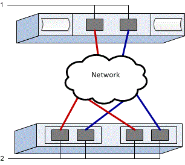

= 在 E 系列中为 VMware 配置 NVMe over TCP 交换机
:allow-uri-read: 
:icons: font
:imagesdir: ../media/

[role="lead"]
对于 NVMe over TCP 协议，您需要配置交换机并确定主机 NVMe 限定名称 (NQN)。

NOTE: 在使用 4096 字节驱动器时，必须将卷设置为使用 512 字节仿真（512e），以确保与 VMware 的兼容性。有关将卷设置为使用 512 字节仿真（512e）的详细信息，请参见 SANtricity System Manager 联机帮助。

[[step-1-record-your-configuration]]
== 步骤 1：记录您的配置

您可以生成并打印此页面的 PDF，然后使用以下工作表记录协议特定的存储配置信息。执行配置任务时需要此信息。

图中显示了连接到由 VLAN 和/或唯一子网分隔的 E 系列存储阵列的主机。一个 VLAN/子网用蓝线表示；另一个 VLAN/子网用红线表示。每个 VLAN/子网至少包含一个启动器端口和一半的目标端口。主机和/或控制器端口的数量将根据网络接口的数量和控制器型号而有所不同。您可能有更多可用端口（每个控制器最多 6 个）。

[[host-mapping-information]]
=== 主机映射信息

[cols="35h,~"]
|===
| 正在映射主机名 |  

| 主机操作系统类型 |  

| 主机 NQN |  

| 目标 NQN |  
|===

[[step-2-configure-the-nvmetcp-switches]]
== 步骤 2：配置 NVMe/TCP 交换机

您可以根据供应商对 NVMe over TCP 的建议配置交换机。这些建议可能包括配置指令以及代码更新。

.关于此任务
此任务描述了为 NVMe over TCP 配置交换机的一般步骤。有关具体说明，请参见交换机供应商的文档。

.开始之前
确保您已具备以下条件：

* 两个独立的网络提供高可用性。确保将 NVMe over TCP 流量隔离到单独的网络段。

.步骤
请参阅交换机供应商的文档。

[[step-3-configure-networking]]
== 步骤 3：配置网络

根据您的数据存储要求，您可以通过多种方式设置 NVMe over TCP 网络。有关为您的环境选择最佳配置的提示，请咨询您的网络管理员。

.关于此任务
此任务描述了通过 TCP 为 NVMe 配置网络的一般步骤。有关具体说明，请参见交换机供应商的文档。

.开始之前
确保您已具备以下条件：

* 为 TCP 流量配置的交换机。

在规划 NVMe over TCP 网络时，请记住， https://configmax.broadcom.com/guest["VMware 配置最大值指南"^]每台服务器支持的最大 TCP NVMe 启动器端口数为 2。您必须考虑此要求，以避免配置过多的路径。

为确保良好的多路径配置，请为 NVMe over TCP 网络使用多个网段。在一个网段上至少放置一个主机端端口和每个阵列控制器的至少一个端口，在另一个网段上放置一组相同的主机端和阵列端端口。在可能的情况下，使用多个以太网交换机来提供额外的冗余。

.步骤
请参阅交换机供应商的文档。

[[step-4-configure-array-side-networking]]
== 步骤 4：配置阵列端网络

您可以使用 SANtricity System Manager 界面在阵列端配置 NVMe over TCP 网络。

.关于此任务
此任务描述如何从 SANtricity System Manager 中的*控制器和组件*页面访问 NVMe over TCP 端口配置。您还可以从 SANtricity System Manager 中的*配置 NVMe over TCP 端口*页面访问此配置。

.开始之前
确保您已具备以下条件：

* 一个存储阵列控制器的 IP 地址或域名。
* System Manager GUI、基于角色的访问控制 (RBAC) 或 LDAP 和目录服务的密码，以便对存储阵列进行适当的安全访问。有关 link:https://docs.netapp.com/us-en/e-series-santricity/um-certificates/overview-access-management-um.html["访问管理"^] 的详细信息，请参见 SANtricity System Manager 联机帮助。

.步骤
. 在浏览器中输入以下 URL： https://<DomainNameOrIPAddress>[]
+
`IPAddress` 是一个存储阵列控制器的地址。

+
首次在尚未配置的阵列上打开 SANtricity 系统管理器时，将显示设置管理员密码提示符。基于角色的访问管理可配置四个本地角色：管理员，支持，安全性和监控。后三个角色具有无法猜测的随机密码。为管理员角色设置密码后，您可以使用管理员凭据更改所有密码。有关四个本地用户角色的详细信息，请参见 SANtricity System Manager 联机帮助。

. 在设置管理员密码和确认密码字段中输入管理员角色的 System Manager 密码，然后单击 * 设置密码 * 。
+
如果未配置任何池、卷组、工作负载或通知，则会启动设置向导。

. 关闭设置向导。
+
您稍后将使用此向导完成其他设置任务。

. 选择 *Hardware* > *Controllers and components*。
. 单击具有要配置的 NVMe over TCP 端口的控制器。
+
此时将显示控制器的上下文菜单。

. 选择 *Configure NVMe over TCP ports*。
+
此时将打开"通过 TCP 配置 NVMe 端口"对话框。

. 在下拉列表中，选择要配置的端口，然后单击 * 下一步 * 。
. 选择配置端口设置，然后单击 * 下一步 * 。
+
要查看所有端口设置，请单击对话框右侧的 * 显示更多端口设置 * 链接。

+
|===
| 端口设置 | Description 

 a| 
已配置以太网端口速度
 a| 
选择所需的速度。下拉列表中显示的选项取决于您的网络可以支持的最大速度（例如 200 Gb/s）。

 a| 
启用 IPv4/Enable IPv6
 a| 
选择一个或两个选项以启用对 IPv4 和 IPv6 网络的支持。

 a| 
MTU 大小（通过单击显示更多端口设置可用。）
 a| 
如有必要，请为最大传输单元（ Maximum Transmission Unit ， MTU ）输入一个新大小（以字节为单位）。

默认最大传输单元 (MTU) 大小为每帧 4200 字节。必须输入介于 1500 和 9000 之间的值。

|===
+
如果选择了 * 启用 IPv* ，则在单击 * 下一步 * 后，将打开一个对话框，用于选择 IPv4 设置。如果选择了 * 启用 IPv6* ，则在单击 * 下一步 * 后，将打开一个对话框，用于选择 IPv6 设置。如果同时选择了这两个选项，则 IPv4 设置对话框将首先打开，然后单击 * 下一步 * ， IPv6 设置对话框将打开。

+
自动或手动配置 IPv4 和 / 或 IPv6 设置。要查看所有端口设置，请单击对话框右侧的 * 显示更多设置 * 链接。

+
|===
| 端口设置 | Description 

 a| 
自动获取配置
 a| 
选择此选项可自动获取配置。

 a| 
手动指定静态配置
 a| 
选择此选项，然后在字段中输入静态地址。对于 IPv4 ，请包括网络子网掩码和网关。对于 IPv6 ，请包括可路由的 IP 地址和路由器 IP 地址。

|===
. 单击 * 完成 * 。
. 关闭 System Manager 。

[[step-5-configure-host-side-networking]]
== 第5步：配置主机端网络

在主机端配置 NVMe over TCP 网络使 VMware NVMe over TCP 存储适配器启动器能够与阵列建立会话。

.步骤
. 识别 TCP 网络适配器并记录 vmnic 配对的上行链路。
+
主机上的网络适配器被命名为 vmnicN，其中 N 是标识网络适配器的唯一数字，例如 vmnic0、vmnic1 等。物理适配器可以在 ESXi 主机的"网络"下查看，也可以在托管 vCenter 的清单中选择 ESXi 主机后从"配置"选项卡中查看。

. 使用 vSphere 标准交换机为 TCP 适配器配置 VMkernel 端口绑定。
+
有关详细信息，请参见link:https://techdocs.broadcom.com/us/en/vmware-cis/vsphere/vsphere/9-1/vsphere-storage/about-vmware-nvme-storage/configuring-nvme-over-tcp-on-esxi/configure-vmkernel-binding-for-the-tcp-adapter.html["为 TCP 适配器配置 VMkernel 绑定"^]。

. 添加软件 NVMe over TCP 适配器。
+
有关详细信息，请参见link:https://techdocs.broadcom.com/us/en/vmware-cis/vsphere/vsphere/9-1/vsphere-storage/about-vmware-nvme-storage/configuring-nvme-over-tcp-on-esxi/configure-vmkernel-binding-for-the-tcp-adapter/configure-vmkernel-binding-for-the-tcp-adapter-with-a-vsphere-standard-switch.html["添加软件 NVMe over RDMA 或 NVMe over TCP 适配器"^]。

. 为基于 TCP 的 NVMe 添加 NVMe 控制器。
+
有关详细信息，请参见 link:https://techdocs.broadcom.com/us/en/vmware-cis/vsphere/vsphere/9-1/vsphere-storage/about-vmware-nvme-storage/configuring-nvme-over-tcp-on-esxi.html["添加基于网络结构的 NVMe 控制器"^]。

NOTE: 在此过程中，可以从"添加控制器"对话框获取主机 NQN。稍后配置主机映射时将需要此信息。

成功添加后，可以从 vSphere Client 上的存储适配器视图中查看连接。如果不成功，请跳到步骤 6 以验证与端口的通信并更正任何连接设置。

[[step-6-verify-ip-network-connections]]
== 第 6 步：验证 IP 网络连接

您可以使用 ping 测试来验证 Internet 协议（ IP ）网络连接，以确保主机和阵列能够进行通信。

.步骤
. 在主机上，运行以下命令：
+
[listing]
----
vmkping <NVMe over TCP_target_IP_address\>
----
+
在此示例中，NVMe over TCP 目标 IP 地址为 192.29.11.111。

+
[listing]
----
vmkping -d 192.29.11.111
PING 192.29.11.111 (192.29.11.111): 56 data bytes
64 bytes from 192.29.11.111: icmp_seq=0 ttl=64 time=0.902 ms
64 bytes from 192.29.11.111: icmp_seq=1 ttl=64 time=0.406 ms
64 bytes from 192.29.11.111: icmp_seq=2 ttl=64 time=0.855 ms
--- 192.29.11.111 ping statistics ---
3 packets transmitted, 3 packets received, 0% packet loss
round-trip min/avg/max = 0.406/0.721/0.902 ms
----
. 从每个主机的启动器地址（用于 NVMe over TCP 的主机以太网端口的 IP 地址）向每个控制器 NVMe over TCP 端口发出 `vmkping`命令。在配置中的每个主机服务器上执行此操作，并根据需要更改 IP 地址。
+

NOTE: 如果命令失败并显示消息 `sendto() failed (Message too long)`，请验证主机服务器、存储控制器和交换机端口上以太网接口的 MTU 大小。

. 如果步骤 5 发现失败，请返回 NVMe over TCP 主机端网络配置过程以完成添加目标控制器。

