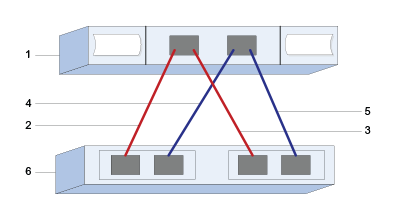

= 配置 E 系列中 VMware 的 SAS 主机端口和设置
:allow-uri-read: 
:icons: font
:imagesdir: ../media/

[role="lead"]
对于 SAS 协议，您可以确定主机端口地址并进行建议的设置。

[[step-1-record-your-configuration]]
== 步骤 1：记录您的配置

您可以生成并打印此页面的 PDF，然后使用以下工作表记录协议特定的存储配置信息。执行配置任务时需要此信息。

图示显示主机直接连接到具有冗余连接的 E 系列存储阵列（假设为 4 端口 SAS HBA）。第一个冗余连接由红线表示；第二个冗余连接由蓝线表示。端口数取决于主机端口数。您可能只有 2 个主机端口。在这种情况下，建议至少使用第一个冗余连接。

[[host-identifiers]]
=== 主机标识符

|===
| 标注编号 | 主机（启动程序）端口连接 | SAS 地址 

 a| 
1.
 a| 
主机
 a| 
_ 不适用 _

 a| 
2.
 a| 
主机（启动程序）端口 1 连接到控制器 A 的端口 1
 a| 

 a| 
3.
 a| 
主机（启动程序）端口 2 连接到控制器 B 的端口 1
 a| 

 a| 
4.
 a| 
主机（启动器）端口 3 连接到控制器 A，端口 1
 a| 

 a| 
5.
 a| 
主机（启动器）端口 4 连接到控制器 B，端口 1
 a| 

|===

[[host-mapping-information]]
=== 主机映射信息

[cols="35h,~"]
|===
| 正在映射主机名 |  

| 主机操作系统类型 |  
|===

[[step-2-determine-sas-host-identifiers]]
== 步骤 2：确定 SAS 主机标识符

使用 esxcli 或 HBA 实用程序查找 SAS 地址。

.关于此任务
查看 HBA 实用程序的准则：

* 大多数 HBA 供应商都提供 HBA 实用程序。

.步骤
. 使用 SSH 或 ESXi shell 连接到 ESXi 主机。要启用 ESXi shell，请参见 https://knowledge.broadcom.com/external/article/311213/using-esxi-shell-in-esxi.html["在 ESXi 中使用 ESXi Shell"^]。
. 运行以下命令：
+
[listing]
----
esxcli storage core adapter list
----
. 记录启动器 SAS 地址标识符（UID 格式为 sas.<SAS_Address>）。输出类似于以下示例：
+
[listing]
----
HBA Name  Driver       Link State  UID                   Capabilities         Description
--------  ----------   ----------  --------------------  -------------------  -----------
vmhba1    lsi_msgpt35  link-n/a    sas.5b083fe0ca0e7000                       (0000:03:00.0) Avago (LSI Logic) SAS3008 12Gbps SAS HBA external
----

在上面的示例中，UID 将仅显示基础 SAS 地址。对于其他端口，前 14 个字符保持不变，只有最后两个字符变化以表示不同的端口。通常，每个端口的最后一位数字只需增加 1。拥有基础 SAS 地址通常足以在主机映射期间识别主机适配器，因为 E 系列阵列将自动检测并列出其他端口 SAS 地址以供选择。使用供应商 HBA 实用程序可能有助于获取每个端口的 SAS 地址。

NOTE: 另一个命令选项是 `esxcli storage san sas list`。这将以十六进制格式显示更多详细信息和基本 SAS 地址，以冒号分隔。
