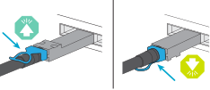
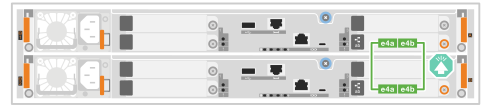
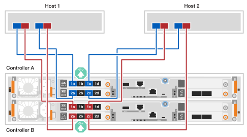
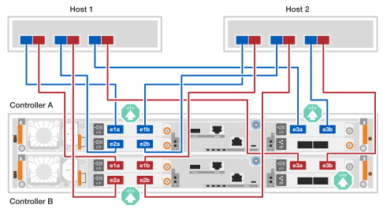
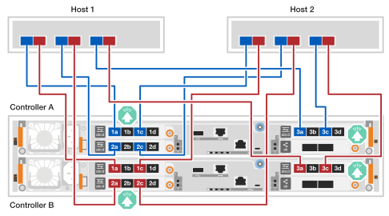
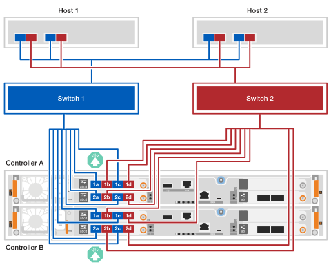
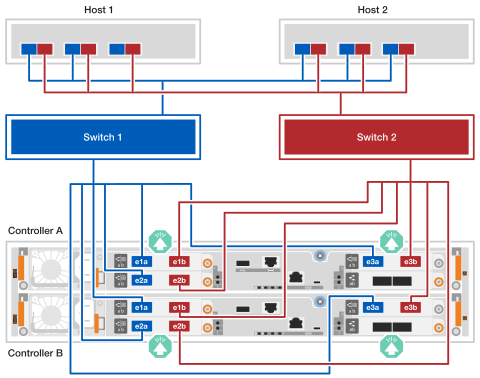
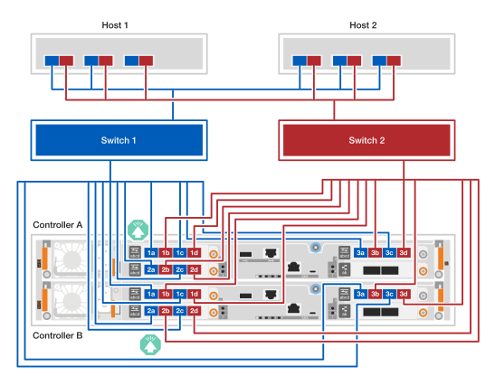
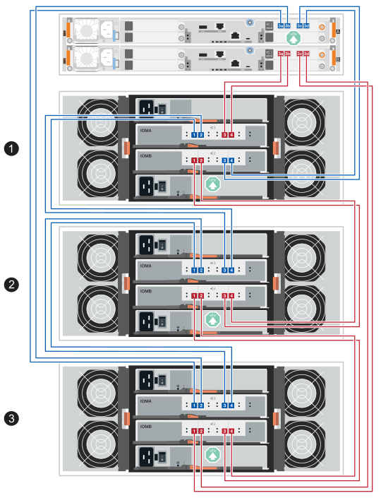

= 用缆线连接 EF50 和 EF80 存储系统的硬件
:allow-uri-read: 
:icons: font
:imagesdir: ../media/

[role="lead"]
安装 EF50 或 EF80 存储系统硬件后，连接控制器间镜像、主机网络连接和 SAS 磁盘架（如果适用）。（稍后在"完成存储系统设置"部分对管理端口进行布线。）

.关于此任务
* 术语 _I/O 模块_ 用于指代本过程中的主机接口卡 (HIC)。
* 电缆图形有箭头图标，显示将连接器插入端口时电缆连接器拉片的正确方向（向上或向下）。
+
插入连接器时，您应该感觉到它咔嗒一声卡入到位；如果感觉不到咔嗒声，请将其取出，翻转后重试。

+

[[step-1-cable-the-inter-controller-mirroring-connections]]
== 步骤 1：连接控制器间镜像连接线

将控制器彼此连接以启用控制器间镜像。控制器间镜像连接可确保完整的系统冗余，并用于缓存镜像和 I/O 传输。EF50 和 EF80 存储系统的布线相同。

NOTE: 无论存储系统中安装的控制器间镜像 I/O 模块的速度如何（存储系统支持 100 GbE 或 200 GbE），您都可以使用随附的 200 GbE 电缆。如果控制器间镜像 I/O 模块的速度为 100 GbE，则连接将以较低的速度（100 GbE）运行。

.步骤
. 将控制器连接在一起：
+
.. 电缆控制器 A 端口 e4a 到控制器 B 端口 e4a。
.. 电缆控制器 A 端口 e4b 到控制器 B 端口 e4b。
+
*200 GbE 以太网电缆*

+

+

[[step-2-cable-the-host-connections]]
== 步骤 2：连接主机电缆

根据您的网络拓扑（直接连接或光纤连接）为存储系统连接主机电缆。

.关于此任务
* 根据您的存储系统型号和正在运行的 SANtricity 版本，支持不同类型的主机 I/O 模块。此过程中的布线示例显示了以太网和光纤通道 (FC) 主机 I/O 模块。
+
要查看存储系统型号支持的所有主机 I/O 模块和插槽优先级，请参阅 link:https://hwu.netapp.com["NetApp Hardware Universe"^]。

* 布线示例未显示主机 1 和主机 2 中的 4 端口 64Gb FC HBA；但是，如果安装了这些 HBA，则以与 2 端口 HBA 相同的方式连接其他端口。

[role="tabbed-block"]
====
.直连式拓扑
--
以下示例显示了使用直接连接拓扑将存储系统连接到主机的布线情况。

.EF50 具有两个 4 端口 64Gb FC I/O 模块
[%collapsible]
=====
.关于此任务
* 布线示例显示了插槽 1 和 2 中的主机 I/O 模块。这是 EF50 存储系统支持的最大主机 I/O 模块数。但是，仅需要插槽 1 中的主机 I/O 模块；插槽 2 中的主机 I/O 模块是可选的。
+
如果您的存储系统安装了一个主机 I/O 模块，则可以忽略与其他主机 I/O 模块的缆线连接，而仅将缆线连接到已安装的主机 I/O 模块。

* 直连存储系统具有两条单独的冗余路径：路径 A 和路径 B。
+
** 路径 A 连接显示为主机和控制器上的蓝色电缆和蓝色端口。它将每个主机上的 HBA 端口连接到控制器 A 端口 a 和 c。
** 路径 B 连接显示为主机和控制器上的红色电缆和红色端口。它将每个主机上的 HBA 端口连接到控制器 B 端口 a 和 c。

* 虽然布线示例显示 I/O 模块端口 a 和 c 连接到主机，但您可以使用端口 a 和 b 或端口 c 和 d。

.步骤
. 用缆线将主机连接到控制器：
+
.. 将主机 1 路径 A（蓝色）HBA 端口连接到控制器 A 的 a 端口（1a 和 2a）。
.. 将主机 1 路径 B（红色）HBA 端口连接到控制器 B 的 a 端口（1a 和 2a）。
.. 将主机 2 路径 A（蓝色）HBA 端口连接到控制器 A 的 c 端口（1c 和 2c）。
.. 将主机 2 路径 B（红色）HBA 端口连接到控制器 B 的 c 端口（1c 和 2c）。
+
*64 Gb/s FC 电缆*

+

+

=====
.具有三个 2 端口 200 GbE I/O 模块的 EF80
[%collapsible]
=====
.关于此任务
* 布线示例显示了插槽 1、2 和 3 中的主机 I/O 模块。这是 EF80 存储系统支持的最大主机 I/O 模块数。但是，仅需要插槽 1 中的主机 I/O 模块；插槽 2 和插槽 3 中的主机 I/O 模块都是可选的。
+
如果存储系统安装的主机 I/O 模块较少，则可以忽略与其他主机 I/O 模块的缆线连接，而仅将缆线连接到已安装的主机 I/O 模块。

* 直连存储系统具有两条单独的冗余路径：路径 A 和路径 B。
+
** 路径 A 连接显示为主机和控制器上的蓝色电缆和蓝色端口。它将每个主机上的 HBA 端口连接到控制器 A 端口 a 和 b。
** 路径 B 连接显示为主机和控制器上的红色电缆和红色端口。它将每个主机上的 HBA 端口连接到控制器 B 端口 a 和 b。

.步骤
. 用缆线将主机连接到控制器：
+
.. 将主机 1 路径 A（蓝色）HBA 端口连接到控制器 A 的 a 端口（e1a、e2a 和 e3a）。
.. 将主机 1 路径 B（红色）HBA 端口连接到控制器 B 的 a 端口（e1a、e2a 和 e3a）。
.. 将主机 2 路径 A（蓝色）HBA 端口连接到控制器 A 的 b 端口（e1b、e2b 和 e3b）。
.. 将主机 2 路径 B（红色）HBA 端口连接到控制器 B 的 b 端口（e1b、e2b 和 e3b）。
+
*200 GbE 电缆*

+

+

=====
.EF80 具有三个 4 端口 64Gb FC I/O 模块
[%collapsible]
=====
.关于此任务
* 布线示例显示了插槽 1、2 和 3 中的主机 I/O 模块。这是 EF80 存储系统支持的最大主机 I/O 模块数。但是，仅需要插槽 1 中的主机 I/O 模块；插槽 2 和插槽 3 中的主机 I/O 模块都是可选的。
+
如果存储系统安装的主机 I/O 模块较少，则可以忽略与其他主机 I/O 模块的缆线连接，而仅将缆线连接到已安装的主机 I/O 模块。

* 直连存储系统具有两条单独的冗余路径：路径 A 和路径 B。
+
** 路径 A 连接显示为主机和控制器上的蓝色电缆和蓝色端口。它将每个主机上的 HBA 端口连接到控制器 A 端口 a 和 c。
** 路径 B 连接显示为主机和控制器上的红色电缆和红色端口。它将每个主机上的 HBA 端口连接到控制器 B 端口 a 和 c。

* 虽然布线示例显示 I/O 模块端口 a 和 c 连接到主机，但您可以使用端口 a 和 b 或端口 c 和 d。

.步骤
. 用缆线将主机连接到控制器：
+
.. 将主机 1 路径 A（蓝色）HBA 端口连接到控制器 A 的 a 端口（1a、2a 和 3a）。
.. 将主机 1 路径 B（红色）HBA 端口连接到控制器 B 的 a 端口（1a、2a 和 3a）。
.. 将主机 2 路径 A（蓝色）HBA 端口连接到控制器 A 的 c 端口（1c、2c 和 3c）。
.. 将主机 2 路径 B（红色）HBA 端口连接到控制器 B 的 c 端口（1c、2c 和 3c）。
+
*64 Gb/s FC 电缆*

+

+

=====
--
.Fabric-attached 拓扑
--
以下示例显示了使用光纤连接拓扑将存储系统连接到主机的布线情况。

.EF50 具有两个 4 端口 64Gb FC I/O 模块
[%collapsible]
=====
.关于此任务
* 布线示例显示了插槽 1 和 2 中的主机 I/O 模块。这是 EF50 存储系统支持的最大主机 I/O 模块数。但是，仅需要插槽 1 中的主机 I/O 模块；插槽 2 中的主机 I/O 模块是可选的。
+
如果您的存储系统安装了一个主机 I/O 模块，则可以忽略与其他主机 I/O 模块的缆线连接，而仅将缆线连接到已安装的主机 I/O 模块。

* 光纤连接存储系统具有两条独立的冗余交换机路径：交换机 1 路径和交换机 2 路径。
+
** 交换机 1 路径连接显示为主机和控制器上的蓝色电缆和蓝色端口。它通过交换机 1 将每个主机上的 HBA 端口连接到控制器 A 和控制器 B 的 a 和 c 端口。
** 交换机 2 路径连接显示为主机和控制器上的红色电缆和红色端口。它通过交换机 2 将每个主机上的 HBA 端口连接到控制器 A 和控制器 B 的 b 和 d 端口。

.步骤
. 将主机连接到交换机。
+
您可以使用交换机上的任何端口。

+
.. 将主机 1 和主机 2 交换机 1 路径（蓝色）HBA 端口连接到交换机 1。
.. 将主机 1 和主机 2 的交换机 2 路径（红色）HBA 端口连接到交换机 2。

. 将开关连接到控制器：
+
.. 电缆开关 1（蓝色）到控制器 A 的 a 和 c 端口（1a、2a、1c 和 2c）。
.. 将电缆开关 1（蓝色）连接到控制器 B 的 a 和 c 端口（1a、2a、1c 和 2c）。
.. 将电缆开关 2（红色）连接到控制器 A 的 b 和 d 端口（1b、2b、1d 和 2d）。
.. 将电缆开关 2（红色）连接到控制器 B 的 b 和 d 端口（1b、2b、1d 和 2d）。
+
*64 Gb/s FC 电缆*

+

+

=====
.具有三个 2 端口 200 GbE I/O 模块的 EF80
[%collapsible]
=====
.关于此任务
* 布线示例显示了插槽 1、2 和 3 中的主机 I/O 模块。这是 EF80 存储系统支持的最大主机 I/O 模块数。但是，仅需要插槽 1 中的主机 I/O 模块；插槽 2 和插槽 3 中的主机 I/O 模块都是可选的。
+
如果存储系统安装的主机 I/O 模块较少，则可以忽略与其他主机 I/O 模块的缆线连接，而仅将缆线连接到已安装的主机 I/O 模块。

* 布线示例显示了每台主机上的三个 HBA。如果您的主机少于三个 HBA，则可以忽略与其他 HBA 的缆线连接，而仅将缆线连接到已安装的 HBA。
* 光纤连接存储系统具有两条独立的冗余交换机路径：交换机 1 路径和交换机 2 路径。
+
** 交换机 1 路径连接显示为主机和控制器上的蓝色电缆和蓝色端口。它通过交换机 1 将每个主机上的 HBA 端口连接到控制器 A 和控制器 B 的 a 端口。
** 交换机 2 路径连接显示为主机和控制器上的红色电缆和红色端口。它通过交换机 2 将每个主机上的 HBA 端口连接到控制器 A 和控制器 B 的 b 端口。

.步骤
. 将主机连接到交换机：
+
您可以使用交换机上的任何端口。

+
.. 将主机 1 和主机 2 交换机 1 路径（蓝色）HBA 端口连接到交换机 1。
.. 将主机 1 和主机 2 的交换机 2 路径（红色）HBA 端口连接到交换机 2。

. 将开关连接到控制器：
+
.. 电缆开关 1（蓝色）到控制器 A 的 a 端口（e1a、e2a 和 e3a）。
.. 电缆开关 1（蓝色）到控制器 B 的 a 端口（e1a、e2a 和 e3a）。
.. 将电缆开关 2（红色）连接到控制器 A 的 b 端口（e1b、e2b 和 e3b）。
.. 将电缆开关 2（红色）连接到控制器 B 的 b 端口（e1b、e2b 和 e3b）。
+
*200 GbE 电缆*

+

+

=====
.EF80 具有三个 4 端口 64Gb FC I/O 模块
[%collapsible]
=====
.关于此任务
* 布线示例显示了插槽 1、2 和 3 中的主机 I/O 模块。这是 EF80 存储系统支持的最大主机 I/O 模块数。但是，仅需要插槽 1 中的主机 I/O 模块；插槽 2 和插槽 3 中的主机 I/O 模块都是可选的。
+
如果存储系统安装的主机 I/O 模块较少，则可以忽略与其他主机 I/O 模块的缆线连接，而仅将缆线连接到已安装的主机 I/O 模块。

* 布线示例显示了每台主机上的三个 HBA。如果您的主机少于三个 HBA，则可以忽略与其他 HBA 的缆线连接，而仅将缆线连接到已安装的 HBA。
* 光纤连接存储系统具有两条独立的冗余交换机路径：交换机 1 路径和交换机 2 路径。
+
** 交换机 1 路径连接显示为主机和控制器上的蓝色电缆和蓝色端口。它通过交换机 1 将每个主机上的 HBA 端口连接到控制器 A 和控制器 B 的 a 和 c 端口。
** 交换机 2 路径连接显示为主机和控制器上的红色电缆和红色端口。它通过交换机 2 将每个主机上的 HBA 端口连接到控制器 A 和控制器 B 的 b 和 d 端口。

.步骤
. 将主机连接到交换机：
+
您可以使用交换机上的任何端口。

+
.. 将主机 1 和主机 2 交换机 1 路径（蓝色）HBA 端口连接到交换机 1。
.. 将主机 1 和主机 2 的交换机 2 路径（红色）HBA 端口连接到交换机 2。

. 将开关连接到控制器：
+
.. 电缆开关 1（蓝色）到控制器 A 的 a 和 c 端口（1a、2a、3a、1c、2c 和 3c）。
.. 电缆开关 1（蓝色）到控制器 B 的 a 和 c 端口（1a、2a、3a、1c、2c 和 3c）。
.. 将电缆开关 2（红色）连接到控制器 A 的 b 和 d 端口（1b、2b、3b、1d、2d 和 3d）。
.. 将电缆开关 2（红色）连接到控制器 B 的 b 和 d 端口（1b、2b、3b、1d、2d 和 3d）。
+
*64 Gb/s FC 电缆*

+

+

=====
--
====

[[step-3-cable-the-sas-shelf-connections]]
== 步骤 3：连接 SAS 磁盘架线缆

以下步骤说明如何将控制器连接到一个 DE460C 磁盘架或由三个 DE460C 磁盘架组成的磁盘架堆栈。

.关于此任务
* 布线示例显示了 DE460C 磁盘架；但是，相同的布线适用于所有受支持的 SAS 磁盘架。有关受支持的 SAS 磁盘架，请参阅 link:https://hwu.netapp.com["NetApp Hardware Universe"^]。
* 有关存储系统和所有布线选项（如光纤）支持的最大磁盘架数，请参见 link:https://hwu.netapp.com["NetApp Hardware Universe"^]。
* 布线过程显示控制器在插槽 3 中具有一个 SAS I/O 模块。这是 SANtricity 12.10 唯一支持的 SAS I/O 模块配置。
* 电缆插图显示控制器 A 电缆连接为蓝色，控制器 B 电缆连接为红色。
* 始终对控制器和一个或多个机架进行电缆连接，以便 A 侧路径 (IOMA) 和 B 侧路径 (IOMB) 有两个电缆连接，如电缆连接图所示。
* 您使用的是存储系统附带的存储电缆，可能是以下电缆类型：
+
*mini-SAS HD 线缆*

+

[role="tabbed-block"]
====
.选项 1：一个 DE460C 磁盘架
--
将每个控制器连接到 DE460C 机架上的每个 IOM12 模块，以便控制器具有到机架的 A 侧路径（IOMA）和 B 侧路径（IOMB）。

.步骤
. 将控制器 A 端口 3a 通过缆线连接到磁盘架 IOMA 端口 1。
. 将控制器 A 端口 3b 通过缆线连接到磁盘架 IOMA 端口 2。
. 将控制器 A 端口 3c 通过缆线连接到磁盘架 IOMB 端口 3。
. 将控制器 A 端口 3d 通过缆线连接到磁盘架 IOMB 端口 4。
. 将电缆控制器 B 端口 3a 连接到托架 IOMA 端口 3。
. 将控制器 B 端口 3b 连接到磁盘架 IOMA 端口 4。
. 将控制器 B 端口 3c 连接到磁盘架 IOMB 端口 1。
. 将控制器 B 端口 3d 连接到磁盘架 IOMB 端口 2。

完成磁盘架的布线后，布线应如下所示：

image:../media/drw_ef50-ef80_1_de460c_cabling_ieops-2981.svg["将控制器端口通过缆线连接到一个 DE460C 磁盘架"]

--
.选项 2：三个 DE460C 磁盘架
--
将三个磁盘架连接在一起（磁盘架到磁盘架连接），然后将每个控制器连接到磁盘架堆栈的每一端（磁盘架 1 和磁盘架 3），以便控制器具有到磁盘架堆栈的 A 侧路径（IOMA）和 B 侧路径（IOMB）。

. 为 IOMA 路径的磁盘架到磁盘架连接布线：
+
.. 使用缆线将磁盘架 1 IOMA 端口 1 连接到磁盘架 2 IOMA 端口 4。
.. 电缆架 1 IOMA 端口 2 到架 2 IOMA 端口 3。
.. 将磁盘架 2 IOMA 端口 1 连接到磁盘架 3 IOMA 端口 4。
.. 使用缆线将磁盘架 2 IOMA 端口 2 连接到磁盘架 3 IOMA 端口 3。

. 为 IOMB 路径的磁盘架到磁盘架连接布线：
+
.. 使用缆线将磁盘架 1 IOMB 端口 1 连接到磁盘架 2 IOMB 端口 3。
.. 电缆架 1 IOMB 端口 2 到架 2 IOMB 端口 4。
.. 将磁盘架 2 IOMB 端口 1 连接到磁盘架 3 IOMB 端口 3。
.. 使用缆线将磁盘架 2 IOMB 端口 2 连接到磁盘架 3 IOMB 端口 4。

. 将控制器 A 的电缆连接到磁盘架 3（IOMA 路径）和 1（IOMB 路径）：
+
.. 电缆控制器 A 端口 3a 到机架 3 IOMA 端口 1
.. 将控制器 A 端口 3b 通过缆线连接到磁盘架 3 IOMA 端口 2。
.. 将控制器 A 端口 3c 通过缆线连接到磁盘架 1 IOMB 端口 3。
.. 将控制器 A 端口 3d 通过缆线连接到磁盘架 1 IOMB 端口 4。

. 将控制器 B 连接到磁盘架 1（IOMA 路径）和 3（IOMB 路径）：
+
.. 电缆控制器 B 端口 3a 到货架 1 IOMA 端口 3。
.. 将控制器 B 端口 3b 通过电缆连接到磁盘架 1 IOMA 端口 4。
.. 将控制器 B 端口 3c 通过电缆连接到磁盘架 3 IOMB 端口 1。
.. 将控制器 B 端口 3d 通过电缆连接到磁盘架 3 IOMB 端口 2。

完成磁盘架的布线后，布线应如下所示：

--
====
.下一步是什么？
为存储系统完成布线后，link:install-power-hardware.html["打开您的存储系统电源"]。
