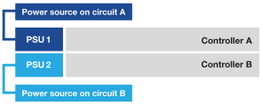

= 打开 EF50 和 EF80 存储系统的硬件电源
:allow-uri-read: 
:icons: font
:imagesdir: ../media/

[role="lead"]
连接 EF50 或 EF80 存储系统电缆后，打开磁盘架电源，分配磁盘架 ID（如果适用）并打开控制器电源。

.开始之前
采取防静电预防措施。

[[step-1-power-on-the-shelves-and-assign-shelf-ids]]
== 步骤 1：打开磁盘架电源并分配磁盘架 ID

打开磁盘架电源，然后为每个磁盘架分配唯一的磁盘架 ID。

.关于此任务
* 为每个磁盘架分配唯一的磁盘架 ID，可确保该磁盘架在存储系统中具有唯一性。
+
有效货架 ID 为 01 至 99。

+
集成在控制器中的内部磁盘架（存储）分配有固定的磁盘架 ID 00。

* 要使机架 ID 生效，必须对机架进行电源循环（关闭 SAS 机架每个电源上的电源开关，等待至少 10 秒钟，然后重新打开电源）。

.步骤
. 首先将电源线连接到磁盘架，用电源线固定器将其固定到位，将电源线连接到不同电路上的电源，然后打开每个电源上的电源开关（位于磁盘架背面），以此为磁盘架接通电源。
+
打开电源后，磁盘架会自动打开电源并启动。

. 取下左端盖，以访问面板上的橙色货架 ID 按钮。
+
image::../media/drw_shelf_id_sas_ieops-2187.svg[更改 SAS 磁盘架 ID]

+
[cols="20%,80%"]
|===

 a| 
image::../media/icon_round_1.png[标注编号 1]
 a| 
货架端盖

 a| 
image::../media/icon_round_2.png[标注编号 2]
 a| 
磁盘架面板

 a| 
image::../media/icon_round_3.png[[标注编号 3]
 a| 
磁盘架 ID 按钮

 a| 
image::../media/icon_round_4.png[[标注编号 4]
 a| 
磁盘架 ID 编号

|===
. 更改磁盘架 ID 的第一个编号：
+
.. 按住磁盘架 ID 按钮，直到数字显示屏上的第一个数字闪烁，然后松开按钮。
+
该号码可能需要长达 15 秒才能闪烁。这将激活磁盘架 ID 编程模式。

+

NOTE: 如果 ID 闪烁时间超过 15 秒，请再次按住磁盘架 ID 按钮，确保将其完全按下。

.. 按下并松开磁盘架 ID 按钮，使编号递增，直到达到所需的编号（0 到 9）。
+
每次按压和释放持续时间可以短至一秒钟。

+
第一个号码继续闪烁。

. 更改磁盘架 ID 的第二个编号：
+
.. 按住按钮，直到数字显示屏上的第二个数字闪烁。
+
该号码最多可能需要三秒钟才能闪烁。

+
数字显示屏上的第一个数字停止闪烁。

.. 按下并松开磁盘架 ID 按钮，使编号递增，直到达到所需的编号（0 到 9）。
+
第二个号码继续闪烁。

. 按住磁盘架 ID 按钮，直到第二个数字停止闪烁，以锁定所需数字并退出编程模式。
+
该号码可能需要长达三秒钟的时间才能停止闪烁。

+
数字显示屏上的两个数字开始闪烁，琥珀色 LED 在大约五秒钟后亮起，提醒您挂起的磁盘架 ID 尚未生效。

. 对磁盘架重新上电至少 10 秒，以使磁盘架 ID 生效。
+
.. 关闭每个电源上的电源开关。
.. 等待 10 秒钟。
.. 打开每个电源的电源开关以完成电源循环。
+
当电源接通时，双色 LED 应亮起绿色。

. 重新装上左端盖。

[[step-2-power-on-the-controllers]]
== 步骤 2：启动控制器

打开磁盘架电源并为其分配唯一 ID 后，再打开控制器电源。

. 将电源线插入每个控制器电源，然后将其连接到不同电路上的电源。
+

NOTE: 如果使用第三方配电装置 (PDU)，请勿直接使用控制器后面的电源插座，因为您可能会阻止对控制器的访问。

+
* 电源线 *

+

+

+
** 系统开始启动。初始启动可能需要长达 8 分钟。
** 系统机箱上的 LED 指示灯闪烁，风扇启动，这表明控制器正在通电。
+
在启动过程中，风扇很大声是正常的。

** 系统机箱正面（挡板后面）的数字显示器不亮。

. 使用每个电源上的固定装置固定电源线。

.下一步是什么？
打开您的存储系统电源后，link:install-complete-setup.html["完成存储系统设置"]。
