= 在E5700中热添加带有IOM12或IOM12B模块的驱动器架
:allow-uri-read: 
:icons: font
:imagesdir: ../media/

[role="lead"]
您可以在存储系统的其他组件仍通电的情况下添加新驱动器架。您可以配置，重新配置，添加或重新定位存储系统容量，而不会中断用户对数据的访问。

.开始之前
* 由于此程序较为复杂，请在开始操作之前阅读所有步骤。
+
当您将磁盘架热添加到一个或多个现有磁盘架时，为了在操作过程中保持系统完整性，您必须始终保持一个活动路径。您必须严格按照所示顺序执行操作步骤。

+
要为新磁盘架布线，请重新连接 A 侧（磁盘架 IOM A）控制器到磁盘架的连接并添加磁盘架到磁盘架的连接，验证 A 侧路径是否处于活动状态，重新连接 B 侧（磁盘架 IOM B）控制器到磁盘架的连接并添加磁盘架到磁盘架的连接，然后验证冗余是否已重新建立。

+

NOTE: 如果要安装以前安装在存储系统中的驱动器架，则必须执行此过程中的其他步骤。

* 确保热添加驱动器架是您所需的操作步骤。
* 确认您的存储系统运行的 SANtricity 版本支持 SAS 扩展盘架，并且不超过支持的 SAS 盘架的最大数量。
+
有关支持的 SANtricity 版本以及存储系统支持的 SAS 扩展盘架最大数量的信息，请参见 NetApp Hardware Universe： https://hwu.netapp.com/Controller/Index?platformTypeId=2357027["Hardware Universe"^]。

+

NOTE: 运行 SANtricity 12.10 或更高版本的 EF50 和 EF80 存储系统支持 SAS 扩展架。

* 您的存储系统必须具有可用的 SAS 端口。这意味着必须已安装 SAS I/O 模块。如果尚未安装，请使用适用的操作步骤安装 SAS I/O 模块，然后返回此操作步骤以热添加驱动器架。
+
** 对于 EF50 和 EF80 存储系统，请使用 link:../maintenance-ef50-ef80/io-module-upgrade.html["升级 I/O 模块"^] 过程。
** 对于较旧的存储系统，请使用_维护系统_部分中适用于您的存储系统型号的 _SAS 扩展卡_过程。

.关于此任务
* 本程序适用于E2800、E2800B、EF280、E5700、E5700B、EF570、EF300、EF600、EF300C、EF600C、E4000、EF50或EF80控制器架。
+

NOTE: 如果要连接较旧的控制器盘架电缆，请参见 https://mysupport.netapp.com/ecm/ecm_download_file/ECMLP2859057["将 IOM 驱动器架添加到现有 E27XX ， E56XX 或 EF560 控制器架"^]。

* 本程序适用于热添加带有 IOM12、IOM12B 或 IOM12C 模块的 DE212C、DE224C 或 DE460C 驱动器架。
+

NOTE: IOM12C 模块仅在 SANtricity OS 11.90R3 及更高版本上受支持。在安装或升级到IOM12C之前、请确保已更新控制器的固件。

[[step-1-prepare-to-add-the-drive-shelf]]
== 第 1 步：准备添加驱动器架

要准备热添加驱动器架，您必须检查是否存在严重事件并检查 IOM 的状态。

.开始之前
* 存储系统的电源必须能够满足新驱动器架的电源要求。有关驱动器架的电源规格，请参见 https://hwu.netapp.com/Controller/Index?platformTypeId=2357027["Hardware Universe"^]。
* 现有存储系统的布线模式必须与此操作步骤中显示的适用方案之一匹配。

.步骤
. 在 SANtricity 系统管理器中，选择 * 支持 * > * 支持中心 * > * 诊断 * 。
. 选择 * 收集支持数据 * 。
+
此时将显示收集支持数据对话框。

. 单击 * 收集 * 。
+
此文件将保存在浏览器的 "Downloads" 文件夹中，名为 support-data.7z 。数据不会自动发送到技术支持。

. 选择 * 支持 * > * 事件日志 * 。
+
"Event Log" 页面将显示事件数据。

. 选择 * 优先级 * 列的标题，将严重事件排序到列表顶部。
. 查看系统严重事件以了解过去两到三周内发生的事件，并验证近期发生的任何严重事件是否已解决或以其他方式解决。
+

NOTE: 如果在过去两到三周内发生未解决的严重事件，请停止操作步骤并联系技术支持。只有在解决了问题描述后，才能继续操作步骤。

. 如果已将IOM连接到硬件、请完成以下步骤。否则、请转至<<step2_install_drive_shelf,第2步：安装驱动器架并接通电源。>>
+
.. 选择菜单：Hardware[Controllers and components]。
.. 选择 * IOM （ ESM ） * 图标。
+
image::../media/sam1130_ss_hardware_iom_icon.gif[IOM (EMM)图标]

+
此时将显示磁盘架组件设置对话框，并选择了 * IOM （ ESM ） * 选项卡。

.. 确保为每个 IOM/ESM 显示的状态为 _optimal_ 。
.. 单击 * 显示更多设置 * 。
.. 确认存在以下条件：
+
*** 检测到的 ESM/IOM 数量与系统中安装的 ESM/IOM 数量以及每个驱动器架的 ESM/IOM 数量匹配。
*** 两个 ESM/IOM 均显示通信正常。
*** DE212C ， DE224C 和 DE460C 驱动器架的数据速率为 12 Gb/ 秒，其他驱动器托盘的数据速率为 6 Gb/ 秒。

[[step-2-install-the-drive-shelf-and-apply-power]]
[[step2_install_drive_shelf]]
== 第 2 步：安装驱动器架并接通电源

您可以安装新的驱动器架或先前安装的驱动器架，打开电源并检查是否存在需要注意的任何 LED 。

.步骤
. 如果要安装的驱动器架先前已安装在存储系统中，请卸下这些驱动器。这些驱动器必须稍后在此操作步骤中安装一个。
+
如果您要安装的驱动器架的安装历史记录未知，则应假定该驱动器架先前已安装在存储系统中。

. 将驱动器架安装在用于存放存储系统组件的机架中。
+

NOTE: 有关物理安装和电源布线的完整操作步骤，请参见适用于您的型号的安装说明。您的型号的安装说明包含一些注释和警告，您必须考虑这些注释和警告才能安全地安装驱动器架。

. 打开新驱动器架的电源，并确认驱动器架上的琥珀色警示 LED 未亮起。如果可能，请先解决所有故障情况，然后再继续使用此操作步骤。

[[step-3-cable-the-drive-shelf]]
== 步骤 3：用缆线连接驱动器架

要将磁盘架连接到存储系统，请将每个控制器连接到单个磁盘架或磁盘架堆叠（如适用），使其具有 A 侧路径 (IOMA) 和 B 侧路径 (IOMB)。如果您有一个磁盘架堆叠，则通过 A 侧路径和 B 侧路径将磁盘架连接在一起（磁盘架到磁盘架的连接）。

始终对控制器和一个或多个机架进行电缆连接，以便 A 侧路径 (IOMA) 和 B 侧路径 (IOMB) 有两个电缆连接，如电缆连接图所示。

[role="tabbed-block"]
====
.连接EF50或EF80的驱动器架
--
此过程指导您如何将初始 SAS 扩展盘架热添加到 EF50 或 EF80 存储系统，以及如何重新连接初始盘架以热添加第二个盘架；但是，添加其他盘架时也可应用此过程。

.开始之前
您已将固件更新到最新版本。要更新固件，请按照中的说明进行操作 link:../upgrade-santricity/index.html["升级 SANtricity OS"]。

.关于此任务
* 如果您正在向一个或多个现有磁盘架热添加额外磁盘架，则适用以下规定：
+
** 此过程指导您重新连接控制器与磁盘架之间的连接，以便始终保持到控制器磁盘架的一条活动路径。
+
要在此过程中保持一个活动路径，请重新连接 A 侧（盘架 IOMA）控制器到盘架的连接并添加盘架到盘架的连接，验证 A 侧路径处于活动状态，重新连接 B 侧（盘架 IOMB）控制器到盘架的连接并添加盘架到盘架的连接，然后验证冗余已重新建立。

** 您始终将电缆从堆栈中的最后一个磁盘架移动到新磁盘架上相同的 IOM 和 IOM 端口，然后将新磁盘架连接到堆栈中上一个最后的磁盘架（磁盘架到磁盘架连接）。

* 此程序包括热添加最多两个磁盘架的步骤。但是，如果要热添加额外的磁盘架，请从第 2 步开始，并将这些步骤应用到额外的磁盘架。
* 此过程显示在插槽 3 中具有一个 SAS I/O 模块的控制器。要查看所有支持的 SAS I/O 模块配置，请参阅 link:https://hwu.netapp.com["NetApp Hardware Universe"^]。
* 在布线图中，控制器 A 的连接显示为蓝色，控制器 B 的连接显示为红色。虚线（蓝色和红色）表示您在执行布线步骤时要移动的现有布线。灰色端口和线条表示在执行布线步骤时保留不动的现有布线。

.步骤
. 要热添加一个作为初始 SAS 扩展架的 SAS 架，请完成以下子步骤；否则，请转到下一步。
+
.. 将控制器 A 端口 3a 连接到磁盘架 IOMA 端口 1。
.. 将控制器 A 端口 3b 连接到机架 IOMA 端口 2。
.. 将控制器 A 端口 3c 连接到机架 IOMB 端口 3。
.. 将控制器 A 端口 3d 连接到机架 IOMB 端口 4。
.. 将控制器 B 端口 3a 连接到磁盘架 IOMA 端口 3。
.. 将控制器 B 端口 3b 连接到机架 IOMA 端口 4。
.. 将控制器 B 端口 3c 连接到机架 IOMB 端口 1。
.. 将控制器 B 端口 3d 连接到机架 IOMB 端口 2。
+
完成磁盘架的布线后，布线应如下所示：

+
image::../media/drw_ef50-ef80_1_de460c_cabling_ieops-2981.svg[为初始磁盘架布线]

. 要热添加第二个 SAS 扩展架（架 2），请按以下步骤重新连接 A 侧控制器到架的连接，并添加 A 侧架到架的连接；否则，请转到下一步。
+
.. 断开电缆与磁盘架 1 IOMA 端口 1 的连接，并将其重新连接到磁盘架 2 IOMA 端口 1。
.. 断开机架 1 IOMA 端口 2 的电缆，并将其重新连接到机架 2 IOMA 端口 2。
.. 将磁盘架 1 IOMA 端口 1 连接到磁盘架 2 IOMA 端口 4。
.. 将磁盘架 1 IOMA 端口 2 连接到磁盘架 2 IOMA 端口 3。
+
完成 A 侧连接的重新布线后，布线应如下所示：

+
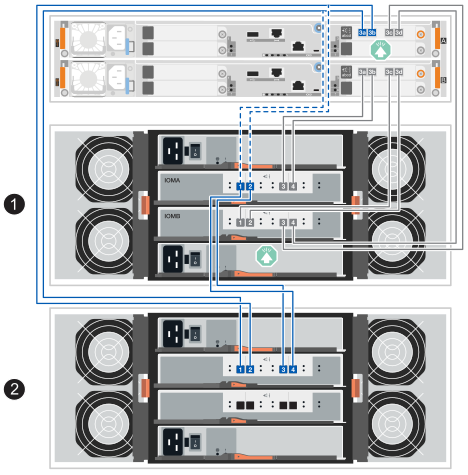

. 在 SANtricity System Manager 中，单击菜单：硬件[控制器和组件]。
+

NOTE: 如果要添加第二个 SAS 扩展盘架，此时在此过程中，您只有一条通往控制器盘架的活动路径。

. 根据需要向下滚动以查看新存储系统中的所有驱动器架。如果未显示新驱动器架，请解决连接问题描述。
. 选择新驱动器架的 * ESM/IOM* 图标。
+
image::../media/sam1130_ss_hardware_iom_icon.gif[ESM/IOM图标]

+
此时将显示 * 磁盘架组件设置 * 对话框。

. 在 * 磁盘架组件设置 * 对话框中选择 * ESM/IOM* 选项卡。
. 选择 * 显示更多选项 * ，然后验证以下内容：
+
** 如果要添加初始 SAS 扩展盘架，则会列出 IOM/ESM A 和 IOM/ESM B。如果要添加第二个 SAS 扩展盘架，则会列出 IOM/ESM A。
** 对于 SAS-3 驱动器架，当前数据速率为 12 Gbps 。
** 卡通信正常。

. 如果要添加第二个 SAS 扩展架，请按以下步骤重新连接 B 侧控制器到磁盘架的连接，并添加 B 侧磁盘架到磁盘架的连接；否则，请转到步骤 10。
+
.. 断开电缆与磁盘架 1 IOMB 端口 1 的连接，并将其重新连接到磁盘架 2 IOMB 端口 1。
.. 断开机架 1 IOMB 端口 2 的电缆，并将其重新连接到机架 2 IOMB 端口 2。
.. 将磁盘架 1 IOMB 端口 1 连接到磁盘架 2 IOMB 端口 3。
.. 将磁盘架 1 IOMB 端口 2 连接到磁盘架 2 IOMB 端口 4。
+
完成B侧连接的重新布线后，布线应如下所示：

+
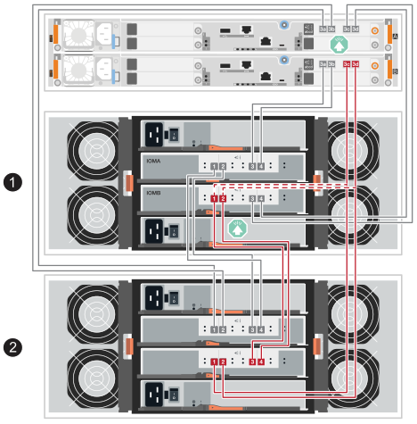

. 如果要添加第二个 SAS 扩展架，完成两个扩展架的重新布线后，布线应如下所示：
+

NOTE: 如果要将第三个磁盘架热添加到两个磁盘架的堆叠中，布线应类似于_Cable the SAS shelf connections_部分中新系统安装的 link:../install-hw-ef50-ef80/install-cable.html#step-3-cable-the-sas-shelf-connections["选项 2：三个 DE460C 磁盘架选项卡"^] 图示。

+
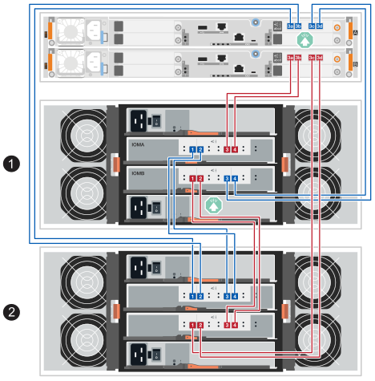

. 如果尚未选中此选项，请在 * 磁盘架组件设置 * 对话框中选择 * ESM/IOM* 选项卡，然后选择 * 显示更多选项 * 。验证卡通信是否为 * 是 * 。
+

NOTE: 最佳状态表示已解决与新驱动器架相关的冗余丢失错误，并且存储系统已稳定。

--
.连接E2800或E5700的驱动器架
--
将驱动器架连接到控制器 A ，确认 IOM 状态，然后将驱动器架连接到控制器 B

.步骤
. 将驱动器架连接到控制器 A
+
下图显示了一个附加驱动器架与控制器 A 之间的连接示例要查找您的型号上的端口，请参见 https://hwu.netapp.com/Controller/Index?platformTypeId=2357027["Hardware Universe"^]。

+
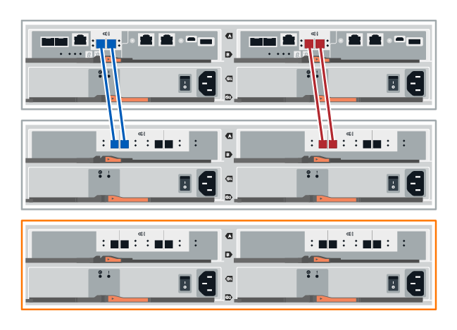

+
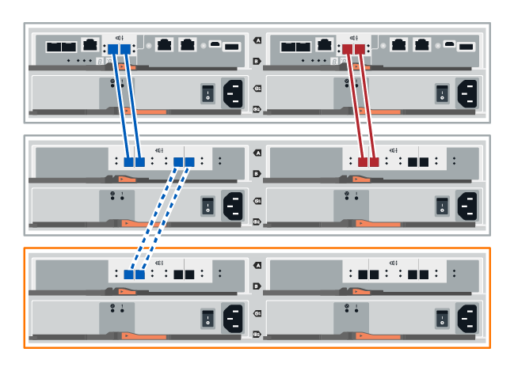

. 在 SANtricity 系统管理器中，单击 * 硬件 * 。
+

NOTE: 此时，在操作步骤中，您只有一条指向控制器架的活动路径。

. 根据需要向下滚动以查看新存储系统中的所有驱动器架。如果未显示新驱动器架，请解决连接问题描述。
. 选择新驱动器架的 * ESM/IOM* 图标。
+
image::../media/sam1130_ss_hardware_iom_icon.gif[ESM/IOM图标]

+
此时将显示 * 磁盘架组件设置 * 对话框。

. 在 * 磁盘架组件设置 * 对话框中选择 * ESM/IOM* 选项卡。
. 选择 * 显示更多选项 * ，然后验证以下内容：
+
** 列出了 IOM/ESM A 。
** 对于 SAS-3 驱动器架，当前数据速率为 12 Gbps 。
** 卡通信正常。

. 断开控制器 B 的所有扩展缆线
. 将驱动器架连接到控制器 B
+
下图显示了一个附加驱动器架与控制器 B 之间的连接示例要查找您的型号上的端口，请参见 https://hwu.netapp.com/Controller/Index?platformTypeId=2357027["Hardware Universe"^]。

+
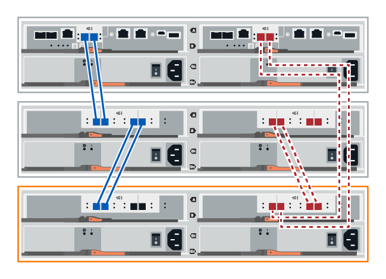

. 如果尚未选中此选项，请在 * 磁盘架组件设置 * 对话框中选择 * ESM/IOM* 选项卡，然后选择 * 显示更多选项 * 。验证卡通信是否为 * 是 * 。
+

NOTE: 最佳状态表示已解决与新驱动器架相关的冗余丢失错误，并且存储系统已稳定。

--
.连接EF300或EF600的驱动器架
--
将驱动器架连接到控制器 A ，确认 IOM 状态，然后将驱动器架连接到控制器 B

.开始之前
* 您已将固件更新到最新版本。要更新固件，请按照中的说明进行操作 link:../upgrade-santricity/index.html["升级 SANtricity OS"]。

.步骤
. 从堆栈中最后一个磁盘架的 IOM12 端口 1 和 2 断开 A 侧控制器缆线，然后将其连接到新磁盘架的 IOM12 端口 1 和 2 。
+
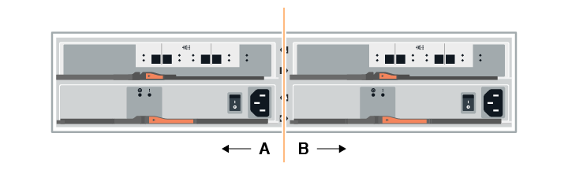

. 将缆线从新磁盘架连接到 A 侧 IOM12 端口 3 和 4 ，再连接到上一个磁盘架的 IOM12 端口 1 和 2 。
+
下图显示了附加驱动器架与上一个驱动器架之间的一端连接示例。要查找您的型号上的端口，请参见 https://hwu.netapp.com/Controller/Index?platformTypeId=2357027["Hardware Universe"^]。

+
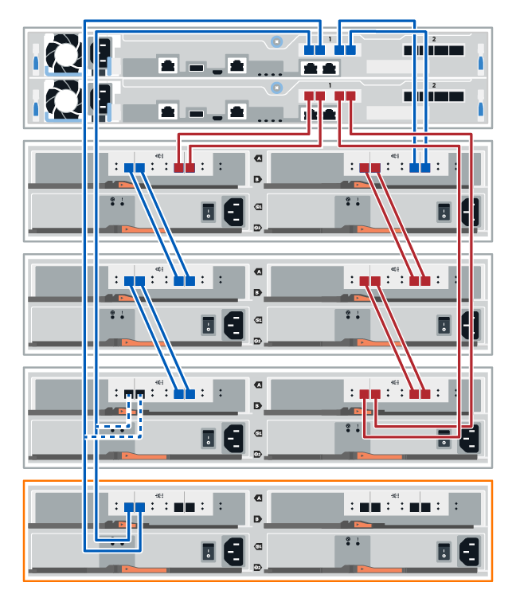

+
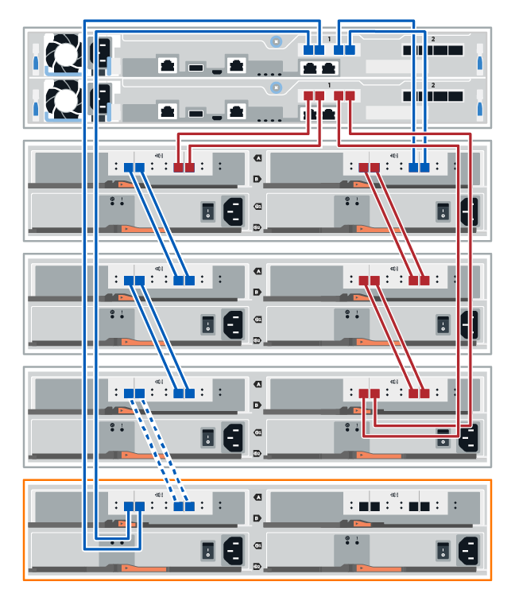

. 在 SANtricity System Manager 中，单击菜单：硬件[控制器和组件]。
+

NOTE: 此时，在操作步骤中，您只有一条指向控制器架的活动路径。

. 根据需要向下滚动以查看新存储系统中的所有驱动器架。如果未显示新驱动器架，请解决连接问题描述。
. 选择新驱动器架的 * ESM/IOM* 图标。
+
image::../media/sam1130_ss_hardware_iom_icon.gif[ESM/IOM图标]

+
此时将显示 * 磁盘架组件设置 * 对话框。

. 在 * 磁盘架组件设置 * 对话框中选择 * ESM/IOM* 选项卡。
. 选择 * 显示更多选项 * ，然后验证以下内容：
+
** 列出了 IOM/ESM A 。
** 对于 SAS-3 驱动器架，当前数据速率为 12 Gbps 。
** 卡通信正常。

. 从 IOM12 端口 1 和 IOM12 端口 2 断开 B 侧控制器缆线与堆栈中前一个磁盘架的连接，然后将其连接到新磁盘架 IOM12 端口 1 和 2 。
. 将新磁盘架上 B 侧 IOM12 端口 3 和 4 的缆线连接到上一个最后一个磁盘架 IOM12 端口 1 和 2 。
+
下图显示了附加驱动器架与上一个驱动器架之间 B 侧的连接示例。要查找您的型号上的端口，请参见 https://hwu.netapp.com/Controller/Index?platformTypeId=2357027["Hardware Universe"^]。

+
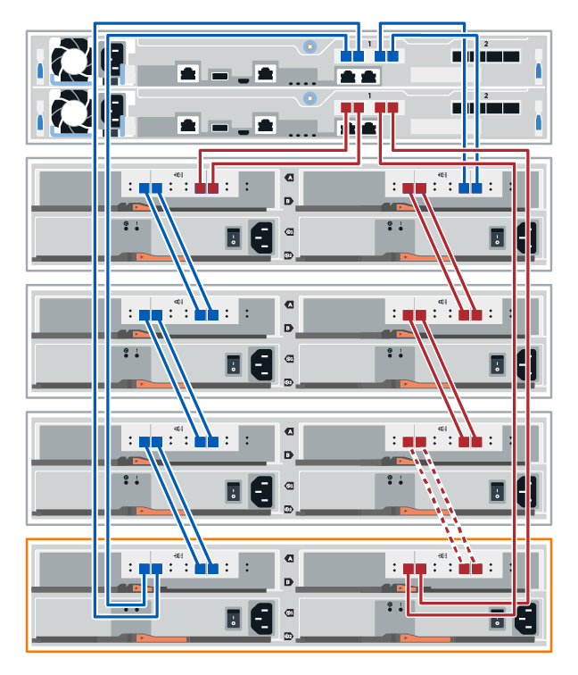

. 如果尚未选中此选项，请在 * 磁盘架组件设置 * 对话框中选择 * ESM/IOM* 选项卡，然后选择 * 显示更多选项 * 。验证卡通信是否为 * 是 * 。
+

NOTE: 最佳状态表示已解决与新驱动器架相关的冗余丢失错误，并且存储系统已稳定。

--
.连接E4000的驱动器架
--
将驱动器架连接到控制器 A ，确认 IOM 状态，然后将驱动器架连接到控制器 B

.步骤
. 将驱动器架连接到控制器 A
+
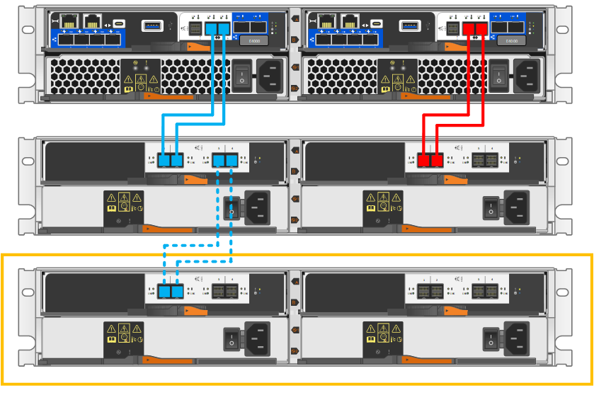

. 在 SANtricity System Manager 中，单击菜单：硬件[控制器和组件]。
+

NOTE: 此时，在操作步骤中，您只有一条指向控制器架的活动路径。

. 根据需要向下滚动以查看新存储系统中的所有驱动器架。如果未显示新驱动器架，请解决连接问题描述。
. 选择新驱动器架的 * ESM/IOM* 图标。
+
image::../media/sam1130_ss_hardware_iom_icon.gif[IOM硬件图标]

+
此时将显示 * 磁盘架组件设置 * 对话框。

. 在 * 磁盘架组件设置 * 对话框中选择 * ESM/IOM* 选项卡。
. 选择 * 显示更多选项 * ，然后验证以下内容：
+
** 列出了 IOM/ESM A 。
** 对于 SAS-3 驱动器架，当前数据速率为 12 Gbps 。
** 卡通信正常。

. 断开控制器 B 的所有扩展缆线
. 将驱动器架连接到控制器 B
+
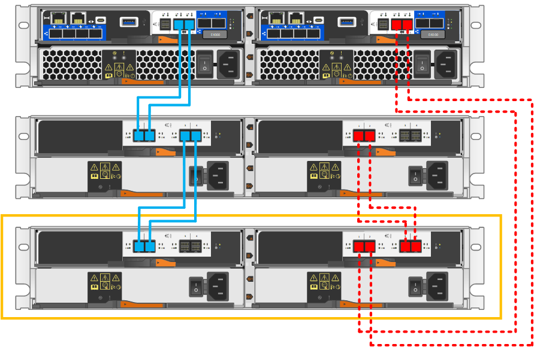

. 如果尚未选中此选项，请在 * 磁盘架组件设置 * 对话框中选择 * ESM/IOM* 选项卡，然后选择 * 显示更多选项 * 。验证卡通信是否为 * 是 * 。
+

NOTE: 最佳状态表示已解决与新驱动器架相关的冗余丢失错误，并且存储系统已稳定。

--
====

[[step-4-assign-drive-shelf-ids]]
== 步骤4：分配驱动器架ID

打开磁盘架电源，然后为每个磁盘架分配唯一的磁盘架 ID。

.关于此任务
* 为每个磁盘架分配唯一的磁盘架 ID，可确保该磁盘架在存储系统中具有唯一性。
+
有效货架 ID 为 01 至 99。

+
集成在控制器中的内部磁盘架（存储）分配有固定的磁盘架 ID 00。

* 要使机架 ID 生效，必须对机架进行电源循环（关闭 SAS 机架每个电源上的电源开关，等待至少 10 秒钟，然后重新打开电源）。

.步骤
. 取下左端盖，以访问面板上的橙色货架 ID 按钮。
+
image::../media/drw_shelf_id_sas_ieops-2187.svg[更改 SAS 磁盘架 ID]

+
[cols="20%,80%"]
|===

 a| 
image::../media/icon_round_1.png[标注编号 1]
 a| 
货架端盖

 a| 
image::../media/icon_round_2.png[标注编号 2]
 a| 
磁盘架面板

 a| 

 a| 
磁盘架 ID 按钮

 a| 
image::../media/icon_round_4.png[[标注编号 4]
 a| 
磁盘架 ID 编号

|===
. 更改磁盘架 ID 的第一个编号：
+
.. 按住磁盘架 ID 按钮，直到数字显示屏上的第一个数字闪烁，然后松开按钮。
+
该号码可能需要长达 15 秒才能闪烁。这将激活磁盘架 ID 编程模式。

+

NOTE: 如果 ID 闪烁时间超过 15 秒，请再次按住磁盘架 ID 按钮，确保将其完全按下。

.. 按下并松开磁盘架 ID 按钮，使编号递增，直到达到所需的编号（0 到 9）。
+
每次按压和释放持续时间可以短至一秒钟。

+
第一个号码继续闪烁。

. 更改磁盘架 ID 的第二个编号：
+
.. 按住按钮，直到数字显示屏上的第二个数字闪烁。
+
该号码最多可能需要三秒钟才能闪烁。

+
数字显示屏上的第一个数字停止闪烁。

.. 按下并松开磁盘架 ID 按钮，使编号递增，直到达到所需的编号（0 到 9）。
+
第二个号码继续闪烁。

. 按住磁盘架 ID 按钮，直到第二个数字停止闪烁，以锁定所需数字并退出编程模式。
+
该号码可能需要长达三秒钟的时间才能停止闪烁。

+
数字显示屏上的两个数字开始闪烁，琥珀色 LED 在大约五秒钟后亮起，提醒您挂起的磁盘架 ID 尚未生效。

. 对磁盘架重新上电至少 10 秒，以使磁盘架 ID 生效。
+
.. 关闭每个电源上的电源开关。
.. 等待 10 秒钟。
.. 打开每个电源的电源开关以完成电源循环。
+
当电源接通时，双色 LED 应亮起绿色。

. 重新装上左端盖。

[[step-5-complete-the-hot-add]]
== 第5步：完成热添加

您可以通过检查是否存在任何错误并确认新添加的驱动器架使用最新固件来完成热添加。

.步骤
. 在 SANtricity 系统管理器中，单击 * 主页 * 。
. 如果页面中央顶部显示标记为 * 从问题中恢复 * 的链接，请单击该链接，然后解决 Recovery Guru 中指示的任何问题。
. 在 SANtricity System Manager 中，单击菜单：硬件[控制器和组件]，并根据需要向下滚动，以查看新添加的驱动器架。
. 对于先前安装在其他存储系统中的驱动器，请一次向新安装的驱动器架添加一个驱动器。请等待识别每个驱动器，然后再插入下一个驱动器。
+
存储系统识别驱动器后， * 硬件 * 页面中的驱动器插槽表示为蓝色方框。

. 选择 * 支持 * > * 支持中心 * > * 支持资源 * 选项卡。
. 单击 * 软件和固件清单 * 链接，然后检查新驱动器架上安装的 IOM/ESM 固件和驱动器固件版本。
+

NOTE: 您可能需要向下滚动此页面才能找到此链接。

. 如有必要，请升级驱动器固件。
+
除非禁用了升级功能，否则 IOM/ESM 固件会自动升级到最新版本。

.下一步是什么？
热添加操作步骤已完成。您可以恢复正常操作。
